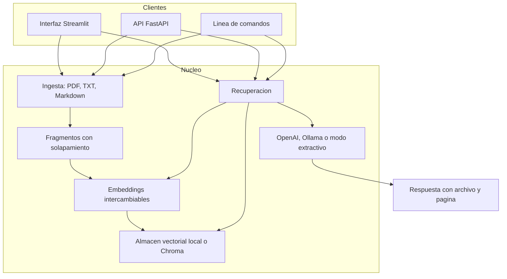

# Folio

[](https://github.com/eniquecerrud/ai-document-assistant/actions/workflows/ci.yml)

Asistente de documentos con generación aumentada por recuperación (RAG). Folio indexa PDF, TXT y Markdown, busca los pasajes más cercanos a una pregunta y responde citando el archivo y la página de cada pasaje. La interfaz, la API y la línea de comandos comparten el mismo índice.

Funciona en español y en inglés. El modelo de embeddings por defecto es multilingüe. Si no hay una clave de API ni un modelo local, el modo **extractivo** devuelve los pasajes recuperados, con su cita, sin salir de la máquina.

## Arquitectura



Cada pregunta es independiente: el historial del chat es solo la conversación en pantalla y no se reenvía al modelo. Las citas estructuradas salen de la recuperación, no de lo que el modelo decida mencionar.

```
src/folio/
  config.py        YAML + variables FOLIO_*
  ingest.py        extracción y fragmentación
  embeddings.py    sentence-transformers, hashing, OpenAI, Ollama
  vectorstore.py   índice NumPy local y Chroma opcional
  llm.py           modo extractivo, API compatible con OpenAI, Ollama
  engine.py        recuperación + generación
  service.py       fachada usada por los tres clientes
  api.py           REST
  cli.py           comando `folio`
  ui/app.py        Streamlit
```

## Requisitos

- Python 3.11, 3.12 o 3.13
- Para el proveedor por defecto: el extra `local` (descarga un modelo de sentence-transformers la primera vez)
- Opcional: una clave de OpenAI, un servidor compatible, Ollama o Chroma

## Instalación

```bash
python -m venv .venv
source .venv/bin/activate
pip install -e ".[local]"
```

Sin el extra `local` se puede usar el proveedor léxico `hashing`, Ollama o un endpoint de embeddings compatible con OpenAI. Las herramientas de desarrollo:

```bash
pip install -e ".[dev]"
pytest
ruff check src tests
```

## Uso rápido

Los ejemplos usan los documentos de [`samples/`](samples/): una política de vacaciones, un manual de teletrabajo, una guía de seguridad y un PDF de dos páginas.

El `folio.yaml` del repositorio deja el modelo de respuestas en `extractive`, que no necesita red. Los embeddings por defecto sí piden el extra `local`. Para probar todo sin descargar modelos:

```bash
export FOLIO_EMBEDDING_PROVIDER=hashing
folio ingest samples/politica-vacaciones.md samples/handbook.txt samples/guia-seguridad.md samples/nota.pdf
folio query "¿Cuántos días de vacaciones hay y con cuánta antelación se piden?"
folio documents
```

La respuesta extractiva cita el archivo y la página. Con un modelo generativo, el texto se redacta y las mismas citas viajan en la salida estructurada.

### Interfaz web

```bash
folio ui
```

Abre [http://127.0.0.1:8501](http://127.0.0.1:8501). Desde la barra lateral se suben archivos, se ven los documentos indexados y se pueden quitar. El chat muestra la respuesta y, debajo, cada fuente con su página y un extracto.

### API

```bash
folio serve
```

Escucha en `127.0.0.1:8000`. No tiene autenticación: no la publiques en una red abierta.

| Método | Ruta | Descripción |
| --- | --- | --- |
| `GET` | `/health` | Estado y versión |
| `POST` | `/ingest` | Multipart, campo `file` (PDF, TXT o Markdown, hasta 20 MB) |
| `GET` | `/documents` | Documentos del índice |
| `DELETE` | `/documents/{id}` | Borra un documento |
| `POST` | `/query` | JSON `{"question": "...", "top_k": 4}` |

```bash
curl -F "file=@samples/politica-vacaciones.md" http://127.0.0.1:8000/ingest
curl -s http://127.0.0.1:8000/query \
  -H 'content-type: application/json' \
  -d '{"question": "¿Cuántos días de vacaciones hay?"}'
curl -s http://127.0.0.1:8000/documents
```

La documentación interactiva queda en [http://127.0.0.1:8000/docs](http://127.0.0.1:8000/docs).

Volver a indexar un archivo con el mismo nombre reemplaza la versión anterior. La clave del índice es el nombre del archivo, no la ruta.

## Configuración

Folio lee, en este orden, un archivo YAML y las variables de entorno. Las variables ganan. Hay una plantilla en [`.env.example`](.env.example) y un ejemplo comentado en [`folio.yaml`](folio.yaml).

```bash
cp .env.example .env
```

El archivo de configuración se busca así: `--config` / `FOLIO_CONFIG`, después `./folio.yaml`, después `./config.yaml`. Si no hay archivo, se usan los valores por defecto del código.

Las claves de API solo se leen del entorno o de `.env`. No las pongas en el YAML y no las subas al repositorio (`.env` está en `.gitignore`).

| Variable | Papel |
| --- | --- |
| `FOLIO_EMBEDDING_PROVIDER` | `sentence-transformers`, `hashing`, `openai` u `ollama` |
| `FOLIO_EMBEDDING_MODEL` | Nombre del modelo de embeddings |
| `FOLIO_LLM_PROVIDER` | `extractive`, `openai` u `ollama` |
| `FOLIO_LLM_MODEL` | Nombre del modelo de lenguaje |
| `FOLIO_LLM_TEMPERATURE` | Temperatura, de 0 a 2 |
| `FOLIO_OPENAI_API_KEY` | Clave. Solo hace falta si un proveedor es `openai` |
| `FOLIO_OPENAI_BASE_URL` | Por defecto `https://api.openai.com/v1` |
| `FOLIO_OLLAMA_BASE_URL` | Por defecto `http://localhost:11434` |
| `FOLIO_VECTORSTORE_PROVIDER` | `local` o `chroma` |
| `FOLIO_VECTORSTORE_PATH` | Directorio del índice. Por defecto `.folio/store` |
| `FOLIO_TOP_K` | Pasajes que se pasan al modelo (1–20) |
| `FOLIO_CHUNK_SIZE` | Tamaño del fragmento, en caracteres |
| `FOLIO_CHUNK_OVERLAP` | Solapamiento, menor que el tamaño |
| `FOLIO_SERVER_HOST` / `FOLIO_SERVER_PORT` | Dirección de `folio serve` |

Si cambias de modelo de embeddings, borra el directorio del índice. Mezclar vectores de distinto tamaño no es válido y Folio se niega a hacerlo.

### sentence-transformers (por defecto)

Proveedor local y multilingüe. El modelo `paraphrase-multilingual-MiniLM-L12-v2` cubre español e inglés en el mismo índice. La primera ejecución lo descarga de Hugging Face y lo guarda en la caché de ese proyecto.

```bash
pip install -e ".[local]"
```

```yaml
embedding:
  provider: sentence-transformers
  model: paraphrase-multilingual-MiniLM-L12-v2
```

### hashing

Línea de base léxica, sin PyTorch y sin red. Agrupa textos que comparten palabras; no entiende sinónimos ni paráfrasis. Es el proveedor de embeddings de la imagen Docker, para que el contenedor arranque sin una descarga de varios cientos de megabytes.

```bash
export FOLIO_EMBEDDING_PROVIDER=hashing
```

### OpenAI y APIs compatibles

Sirve para la API oficial y para cualquier servidor que exponga `/embeddings` y `/chat/completions` (LM Studio, el modo compatible de Ollama en el puerto `/v1`, Groq, etc.).

```bash
export FOLIO_OPENAI_API_KEY=sk-...
export FOLIO_OPENAI_BASE_URL=https://api.openai.com/v1
export FOLIO_EMBEDDING_PROVIDER=openai
export FOLIO_EMBEDDING_MODEL=text-embedding-3-small
export FOLIO_LLM_PROVIDER=openai
export FOLIO_LLM_MODEL=gpt-4o-mini
```

Ejemplo apuntando a Ollama a través de su API compatible:

```bash
export FOLIO_OPENAI_API_KEY=ollama
export FOLIO_OPENAI_BASE_URL=http://localhost:11434/v1
export FOLIO_EMBEDDING_PROVIDER=openai
export FOLIO_EMBEDDING_MODEL=nomic-embed-text
export FOLIO_LLM_PROVIDER=openai
export FOLIO_LLM_MODEL=llama3.2
```

La clave no puede quedar vacía: los servidores compatibles suelen aceptar cualquier valor, pero Folio exige que la variable exista para no llamar al endpoint por accidente.

### Ollama (API nativa)

Usa `/api/embed` y `/api/chat`. Hace falta Ollama 0.5 o posterior para el endpoint de embeddings por lotes.

```bash
ollama pull llama3.2
ollama pull nomic-embed-text
export FOLIO_OLLAMA_BASE_URL=http://localhost:11434
export FOLIO_EMBEDDING_PROVIDER=ollama
export FOLIO_EMBEDDING_MODEL=nomic-embed-text
export FOLIO_LLM_PROVIDER=ollama
export FOLIO_LLM_MODEL=llama3.2
```

### Modo extractivo

```yaml
llm:
  provider: extractive
```

No redacta: muestra los pasajes recuperados, numerados, con archivo y página. Es el valor por defecto de `folio.yaml` y lo que usa la suite de pruebas como forma de respuesta citada. Para una respuesta redactada, cambia el proveedor a `openai` u `ollama`.

### Almacén vectorial

`local` guarda una matriz NumPy (`vectors.npz`) y un `manifest.json` en `FOLIO_VECTORSTORE_PATH`. No hay un servicio aparte. El índice completo se carga en memoria, así que está pensado para colecciones personales, no para millones de fragmentos.

`chroma` usa una colección persistente de ChromaDB con distancia coseno:

```bash
pip install -e ".[chroma]"
export FOLIO_VECTORSTORE_PROVIDER=chroma
export FOLIO_VECTORSTORE_PATH=.folio/chroma
```

La interfaz es la misma (`replace_document`, `search`, `list_documents`, `delete_document`). El resto del programa no sabe cuál de los dos está debajo.

Los TXT y los Markdown se tratan como una sola página (página 1), así la cita siempre tiene archivo y página. En un PDF, el número es el de la página dentro del archivo.

## Docker

La imagen instala el paquete base, sin PyTorch. Compose deja los embeddings en `hashing` y las respuestas en `extractive`, y los dos servicios comparten el volumen del índice.

```bash
docker compose up --build
```

- API: [http://127.0.0.1:8000/docs](http://127.0.0.1:8000/docs)
- Interfaz: [http://127.0.0.1:8501](http://127.0.0.1:8501)

Para incluir sentence-transformers en la imagen:

```bash
docker compose build --build-arg INSTALL_LOCAL=1
```

Ollama es un perfil aparte. Hay que descargar los modelos una vez:

```bash
docker compose --profile ollama up --build
docker compose exec ollama ollama pull llama3.2
docker compose exec ollama ollama pull nomic-embed-text
```

Y arrancar los servicios de Folio con los proveedores nativos:

```bash
FOLIO_EMBEDDING_PROVIDER=ollama \
FOLIO_EMBEDDING_MODEL=nomic-embed-text \
FOLIO_LLM_PROVIDER=ollama \
FOLIO_LLM_MODEL=llama3.2 \
docker compose --profile ollama up --build
```

Dentro de Compose, la URL de Ollama es `http://ollama:11434` (ya es el valor por defecto del archivo).

## Desarrollo

```bash
pip install -e ".[dev]"
ruff check src tests
ruff format --check src tests
pytest
```

`pytest` no abre la red, no descarga modelos y no lee claves. Los proveedores de embeddings y de lenguaje se sustituyen por dobles deterministas; las llamadas HTTP se hacen contra un transporte falso. La integración continua ejecuta Ruff y pytest en Python 3.11, 3.12 y 3.13.

## Limitaciones

- El modo extractivo no resume ni parafrasea. Enseña los fragmentos recuperados.
- `hashing` no es un modelo semántico. Dos frases con las mismas palabras se parecen; un sinónimo, no.
- sentence-transformers descarga varios cientos de megabytes la primera vez. El modelo es pequeño y generalista: cita bien políticas y manuales, y puede fallar en preguntas que exigen cruzar muchos fragmentos.
- No hay OCR. Un PDF escaneado, sin capa de texto, se rechaza porque no contiene texto.
- Los PDF cifrados no se abren.
- El índice identifica el documento por el nombre del archivo. Dos rutas distintas con el mismo nombre son el mismo documento.
- Cada pregunta se responde sola. «¿Y en verano?» no recuerda el turno anterior.
- El almacén local carga todos los vectores en memoria.
- La API no autentica a quien llama. El valor por defecto es escuchar solo en localhost.
- Cambiar el modelo de embeddings obliga a borrar el índice: las dimensiones no se mezclan.
- Un modelo generativo puede redactar mal incluso cuando las citas son las correctas. Las fuentes van junto a la respuesta para poder comprobarlo.
- Folio no ejecuta el código ni los scripts que pueda contener un PDF; solo lee el texto. Aun así, no indexa archivos que no controlas si el contenido pudiera ser confidencial para un proveedor en la nube: en ese caso deja el proveedor en `extractive` o en Ollama local.

## Licencia

[MIT](LICENSE).
